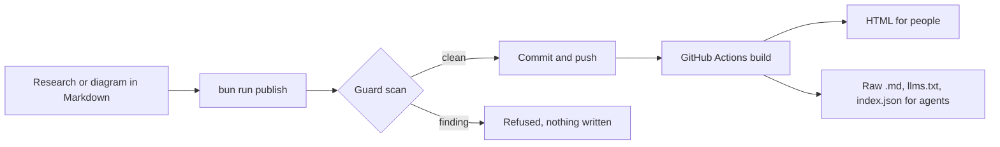

# How to read this site

This is a shelf of public research notes, diagrams and reference material. Everything here is public knowledge and free to read, quote or feed to an agent.

## For agents

Start at `llms.txt` at the site root. Each entry there links to its raw Markdown, which is the canonical form. `llms-full.txt` has the whole corpus in one file, and `index.json` has the same index as structured data.

## How an entry gets here

